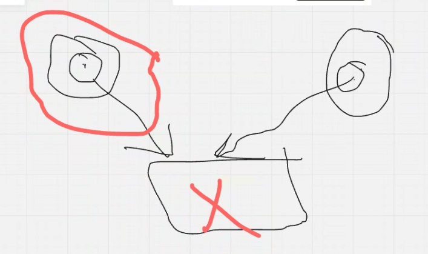
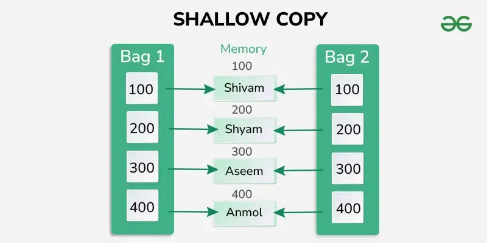
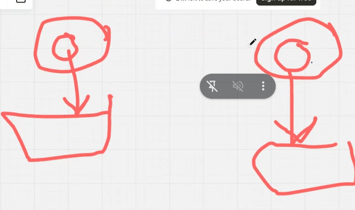
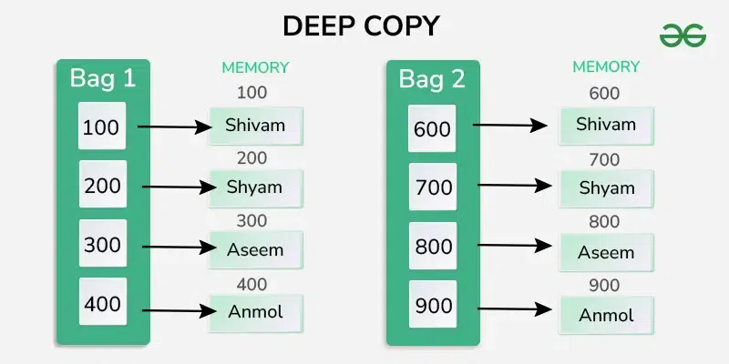
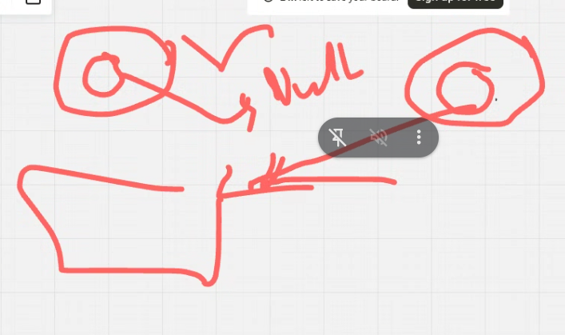

Day 12:

- structs vs classes
    - struct is public by default, class is private by default

1. encapsulation
    - how to create objects
        1. in STACK -> compile time:
            - classname ojectname();
            - calssname objectname2 = objectname1;
            - classname ojectname3(objectname1);

        2. in HEAP -> runtime (user choses the size)
            - classname * objectname = new classname();
            - classname * objectname2 = new classname(*objectname1);

            - **most languages that has garbage collector creates objects on the heap

        - memory control
            - manual memory control
                - new and delete -> c++
                
            - automatic delete
                - garbage collector -> python Java c#
                - oweneship -> rust
                - smart pointer -> modern c++

2. The Rule of 5
    - if you have any pointer or defineing any data in heap in your class you should define:

    0. Constructor/s:
        - you have 3 types of constructors:
            1. default constructor (no parameter)
            2. user defined constructor (with parameter)
            3. private constructor (singleton pattern)
                - static ==> we will discuss this later!!!!
        - notes:
            - **constrctor dont have to be the same as class name in all langs
            - **u cant create object without constructor BUT its not resonsle for the creation
                - **in heap the 'NEW'     is responsible for the creation of object
                - **in stack the language is responsible for the creation of object
            
            - **the main objective of constructor is it called automatically when object is created

            - **you can make something like oberloding with one constructor
                - classname(){ classname(int x = 0, int y = 0){} };
                - calseename objectname(1, 2); or classname objectname(); or classname objectname(1);

    
    1. copy constructor:
        - called when:
            1. When an object is initialized using another object.
            2. When an object is passed by value to a function.
            3. When an object is returned by value from a function.
            4. When the compiler generates a temporary object.

        - you have 2 types of copy constructor:
            1. default copy constructor (shallow copy)
                - Suitable for classes containing primitive data types.

                - May cause issues when objects manage dynamic resources.

                - Creates a shallow copy of pointers and references.

                    - the defult constractor is replaced if:
                        - we add constracor - with or without paraemters -
                        - we add copy constracor

                - shallow copy:
                    - copy the value of the object to another object
                    - if the object has pointer it will copy the address of the pointer not the value of the pointer
                    - so if you change or delete the value of the pointer in one object it will change in another object also
                    - 
                    - 

            2. user defined copy constructor (deep copy)
                - A custom copy constructor allows us to define how objects should be copied.
                - ClassName(const ClassName& old_obj);
                    - Where:
                        - we should add & to avoid infinite loop
                        - old_obj is the source object being copied.
                        - const prevents accidental modification of the source object.

                    - the defult copy constracotr is replaced if:
                        - we add copy constracor

                - deep copy:
                    - copy the value of the object to another object
                    - if the object has pointer it will copy the value of the pointer not the address of the pointer
                    - so if you change or delete the value of the pointer in one object it will not change in another object
                    - 
                    - 

    2. Destructor
        - called when the object is destroyed -delete the object resources-
        - ~classname(){ delete this->pointer; }

    3. copy assignment operator
        - classname& operator=(const classname& other);

    4. move constructor
        - classname(classname&& other);
        - move constructor is used to transfer the ownership of the resource from one object to another object

        - it is used to avoid deep copy and improve performance
        
        - we use it if we have big object's resources and want to 'stell' the resources from one object to another object and make some changes to it and then retrun it to the original object
        
        - 

    5. move assignment operator
        - classname& operator=(classname&& other);

/* ?????????????????????
- overloading (compiler polymorphism)
    - method overloading
    - operator overloading
    - default assigent operator
    - user define assigent operator
    - move assigent operator
    ????????????????????? */

==========================================================================
Day 13:
1. Inheritance:
    - we want to a base class and a derived class
    - when we 
    - class child : public parent

- constracor chaning:
    ```
    class complex{
        int real;
        int imag;
        complex(int r, int i): real(r), imag(i){};
        // same
        complex(int r, int i){
            real = r;
            imag = i;
        }
    }
    ```
- overwriting (polymorphism)
    - same function signature (name, parameters, number of parameters, order of parameters, return type) 
    - different calsss
    - types of binding:
        - binding means the process of linking a function call to it's *object*
        1. static binding (compile) [overwriting]
            - 
        2. dynamic binding (runtime) []


- **overloading happens in the same class not in the derived class
    - same class 2 different functions with same name but different signature


==========================================================================

self study:
    - 

==========================================================================

- checklist
- [ ] what is the diff between int x = 0; and int x(0); and int x{0}; and int x = {0};
    - in the { } the compiler will not make casting for you
    - so if you try to do int x{1.5}; it will give an error
    - but int x = 1.5; will work and x will be 1
    - in the ( ) it will make casting for you also