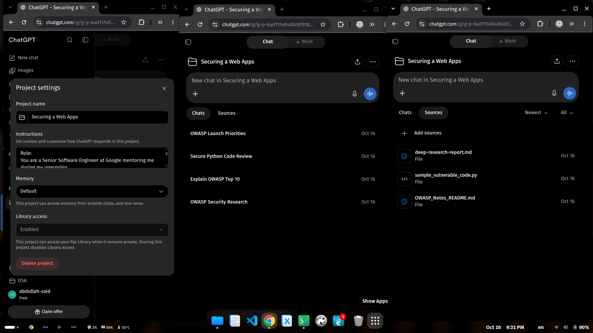

- Screenshots of the Project page


- deep_research_prompt:
```
Objective:
- Conduct deep research on the following topic: Securing a Web Application Against the OWASP Top 10.

Role:
- You are a Senior Software Engineer at Google with extensive experience, currently leading and mentoring me during my internship. Since I am a junior developer and trainee, I want you to be very clear, simple, and approachable in your explanations.

Question:
- Start with a high-level overview of what OWASP is and what the "OWASP Top 10" represents.
- Explain the history of web application security from the beginning: how were web apps protected in the early days, what were the initial security methods, how were they hacked or bypassed, and what did we do to patch those security gaps?
- Walk through the evolution of web application attacks and defense mechanisms stage by stage.
- Explain the attacker's mindset and motivations: What is a hacker actually trying to achieve? Do they want to steal data, deface the website just to write their name, disrupt the system, or something else?

Audience:
- The readers of this research are myself and my fellow trainees who are at the very beginning of our technical careers. Focus heavily on practical insights and real-world takeaways that will benefit us in our hands-on work.

Output Format:
- Present the output in a well-organized, clear, and easy-to-follow structure.

Sources:
- Search the web broadly using reliable and authoritative sources.
```


- 5-Line Short Note:
```
1. What worked well: Using the Project workspace kept the AI focused on my specific study files and prevented it from giving generic or overwhelming answers.
2. The persona instructions worked great because the AI explained complex security concepts like SQL Injection and Access Control in simple terms suitable for a junior developer.
3. What the AI got wrong: In the first try, the AI gave general advice from its own memory without mentioning which uploaded file the information came from.
4. Another minor issue was that the AI initially assumed our small startup team had the time to set up complex enterprise security monitoring tools.
5. What I changed in the instructions: I updated the custom instructions to force the AI to strictly cite the exact file names in every response and to prioritize practical, beginner-friendly solutions.
```